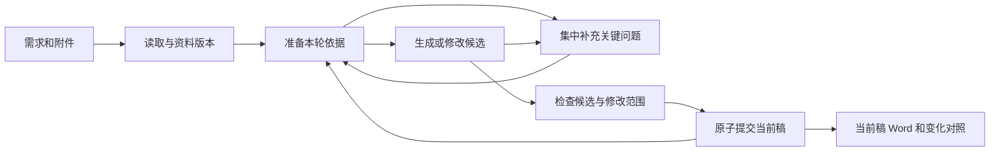

# 开工规格 v0.3

## 1. 首版承诺与范围

首版面向一个试点单位的材料撰写和核稿人员。电脑网页是用户入口。用户输入自然语言并上传材料，四条路径分别交付经验起草、经验改稿、方案起草和方案改稿。正文可编辑，可下载同版 Word。方案包含可编辑任务分工表，改稿附可展开对照。用户要求精确复刻样式时，先由试点模板实测确定支持范围。

业务流程的主版本由本项目 Web 服务持有。Codex 和 Claude Code 首先用于核心试验和强基线比较。平台接入在网页验收后按真实需求安排。正式发文审批、组织级知识库、自动网络取材、OCR、Word 原生修订和多人同时编辑不计入本阶段交付。并发保护仍覆盖同一用户开多个标签页，以及用户手改与后台生成同时发生。

普通请求有足够材料即可出一份完整稿。助手集中展示真正影响下笔的问题，如当年事实的权威来源、要求改动的截止日期与锁定章节发生冲突。材料不足的经验任务可提供有明确空缺的结构稿，工作方案可以根据目标给建议稿。待核状态贯穿预览、下载与历史记录。

## 2. 分层和接口

| 层 | 权威输入与输出 | 实现职责 |
|---|---|---|
| 用户页面 | 需求、附件角色提示、用户确认、编辑、下载 | 显示任务理解、材料读取结果、当前稿和变化。无法确认页码或读取范围时按实际能力显示 |
| 解析与任务服务 | 原始文件/粘贴文本 → 有定位的 Source 版本和资料清单 | 文件签名、大小和展开上限校验，隔离处理，保留原始文件。DOCX 标题/段落/简单表格、文本 PDF、CSV/XLSX 首批实际验证。公式只用可确认的已有值并标明来源，未读取区域显式提示 |
| 写作准备 | 当前任务、资料片段、需求、硬锁 → 依赖签名和模型输入 | 合并本轮确认和适用规则，裁剪资料但保留指定关键材料，记录覆盖不足；初次识别错误允许用户更正 |
| 写作模型 | 固定核心 Prompt、场景 Skill、任务上下文 → 候选稿或集中问题 | 做业务判断、组织和写作，模型只产生建议结构和文本 |
| 版本与检查服务 | 候选、基础版、锁定规则、资料与检查签名 → 候选审查和当前稿 | 生成稳定 ID、做结构检查与权限判断、原子提交。正文差异和修改摘要按真实变化生成 |
| 交付服务 | 已提交版本、检查状态、模板 → Word 与附件回执 | 同一文档模型生成预览和 Word，解析 Word 反查关键内容。只对明确版本写文件，可单独重试导出 |

起步采用单一 Python Web 服务、关系型存储和任务级文件区。本地试验可用 SQLite。前端保留提交、当前稿、意见与下载的最小页面。具体依赖与模型服务在开工环境中选定和锁定。每个业务动作使用 [workflow.json](../contracts/workflow.json) 的名字。浏览器可用任务提交、任务读取、动作提交、按版本下载四类端点，不需要给每个内部步骤做外部接口。任务所有权在服务端按可信身份验证，模型输出和浏览器传来的任务 ID 不能作为授权。

规则的维护入口各自唯一。核心 Prompt 管写作模型输入输出，Skill 管文种和改稿规则，工作流契约管动作和状态，服务端管校验和持久化，项目 AGENTS.md 管开发约束。单位样式只注入被批准的称谓、层级和语言偏好。正文、附件和样稿中的命令式内容始终按业务资料解释。

## 3. Workflow 与交接责任

| 交接点 | 交付给下一步的东西 | 不足时由谁处理 |
|---|---|---|
| 读取 → 准备 | 已读取区域、定位、版本、不可读范围及输入角色提示。纯文本可形成来源，无附件的建议方案可继续 | 解析负责真实报告失败，准备阶段决定是否需用户补文 |
| 准备 → 写作 | 冻结本轮需求、选定依据、锁定范围与基础版本。无实质阻断时直接写作 | 权威事实不清或约束互斥时，准备阶段发起集中澄清。模型发现新增冲突也可返回同一种问题结果 |
| 写作 → 检查 | 一份结构化候选或问题，正文与分工使用共享任务字段 | 漏项回写作局部修复。来源不可得回准备补证，越界或过时的候选由版本服务拦下 |
| 检查 → 当前稿 | 当前候选的检查记录，标明阻断项与待核项。版本和范围检查通过才原子提交 | 严重结构错误、越权与版本冲突保留父版。能安全保留待核项的稿可按草稿提交 |
| 当前稿 → 下载 | 同一 revision、来源版本和模板的 Word，显示生成状态与历史入口 | 导出端处理排版、生成和文件故障，恢复按同一版本重试。语义缺陷回内容阶段 |

**当前稿与候选。** 起草在无当前版本时用空基础版。导入待改稿先保存为父版，保留原始字节。每次模型写作绑定 `basis_key`，该标识由服务端根据任务、基础版、资料版本、需求/锁定及规则计算。同一尝试的签名随候选与审查保留，提交后签名仍指向该次生成的基础版。当前版本的检查是否有效另按它绑定的版本与活动依赖核对。候选提交要核对本轮依据与当前活动依据，确保用户手改、资料替换、单位规则变化都能拒绝旧结果。手改与恢复形成新版本并重验。查询只读。

**状态。** `ready_for_review` 代表该轮当前稿已提交、审查状态可读。`needs_input` 允许查看已有父版。导出进度独立记录。系统检查完成可给“可审阅”，有待核事项显示“草稿待核”。“用户已认可”需要用户明确认可当前可审阅版本。用户对事实的新确认单独写入依据，不能由“我满意”倒推。

**正文与任务表。** 方案中重复出现的责任、节点和交付物使用共享字段槽，例如 `{{plan:p1:time_window}}`。渲染时填入同一个结构化值，表格也由同一记录生成。禁止未解析槽出现在正文或 Word。修改字段后，以渲染后的旧版/新版核锁定内容，防止模板字符串相同却显示不同日期。用户在网页编辑关联任务字段时先改同一个任务记录。若用户把一段关联文字改为自由文本，保留手改并标出断开同步的字段，重新导出前做一致性核对。

**候选检查顺序。** 先校验结构、任务身份和 `basis_key`。证据 ID、要求 ID 和任务字段槽须能在本轮依据或候选中解析，事实引用须具备相应角色与语义支持。按操作列表顺序应用补丁，替换保留块 ID，插入使用新 ID，移动或删除只作用于已有 ID。拒绝重复 ID、无效锚点和范围外变更。核锁检查保留块的类型、渲染文本与受保护块之间的相对次序。插入或移动需位于获准范围内。选区修改只允许变更授权的任务记录，且每项变更都须对应本轮需求。关联到范围外段落的影响同样触发冲突。对方案字段，`pending` 使用 `null` 和具体原因，其余状态须有实际值，要求或用户决定附对应依据。结构、授权、锁定或依赖检查失败时保留父版。已披露且可安全保留的待核项允许提交为草稿。

**恢复与计时。** 对每次模型调用和导出保存请求身份、依据签名、已知回执及状态。超时先查同一请求。只有确认未执行且可安全重试时，才允许一次自动恢复。确定性错误在原因修好后重试受影响步骤。模型审查发现的问题必须指向段落和依据。重复同样输入和同样方法没有信息增益时，保留现状并定位解析、写作、审核或导出的真实缺陷。

端到端从首次提交计到首份完整 Word 可下载，另计首个完整可读稿、每轮意见提交到新 Word、用户主动核改时间。运行记录拆为读取、资料准备、模型请求、检查、导出和恢复，另列用户补充及外部准备。并发区间在总耗时中取并集，未知留空并说明。记录正常调用与无变化的重复调用，既保留必要核对也能找出真正浪费。比较同等资料范围、交付物和人工检查条件。

## 4. Scale 与初始运行边界

这里同时保留 Skill 和 Scale。Skill 指写作规则包。Scale 指材料容量、模型工作量和质量量表。以下数字是试点设计参数，待首次真实样本校准。

| 项目 | 初始设计 | 触及边界时 |
|---|---|---|
| 附件 | 默认每任务最多 10 份，合计 30 MiB。以实际文件和解压资源独立校验 | 先说明具体超限项，请用户选材料或提供摘要。保留已登记内容 |
| 资料上下文 | 根据已配置模型的真实上下文和输出预算计算。选当前需求、关键事实、锁定段落、邻近段落和任务表，按 ID 附定位 | 缺必需信息则分批读取或请用户缩小范围。不能无提示截断必需资料 |
| 模型调用 | 已有明确输入的正常轮以一次写作调用为目标。解析、比对、生成文件走程序。存在确定缺陷才做一次有针对性的自动修正，新增依据或用户意见另计 | 同一故障未改善就停在可恢复状态，保留父版和原因。质量不足以待核或需用户补充呈现 |
| 范围和并发 | 一个试点单位，每任务同一时刻允许一个写作尝试占有当前尝试位。手改不被锁住，提交时比对版本 | 新意见可启动下一轮或等待当前尝试，新旧结果始终归属自己的请求 |
| 用量与数据 | 试点负责人开工时明确模型环境、可传材料类别、日志脱敏、保留周期和成本上限 | 运行环境与材料权限未明确时，先做本地结构和模板工作。开工前确认数据到哪、谁能看、如何清理 |

原始内容、正文和来源仅在任务作用域内可访问。默认日志留事件名、ID、耗时、版本和错误码。对外查找能力按真实需求另议。材料按已确定的单位存储和清理规则处理。用户访问任务、候选、历史和文件下载均经过同一权限检查。

## 5. 实施顺序与收口

| 切片 | 具体产物 | 下一步所需证据 |
|---|---|---|
| S0 基线与材料 | 一份真实脱敏方案改稿及原附件、保护项和核稿依据，选定试点 Word/WPS 和可用模型 | 首条样本可核稿，A/B 在首次 C 调优前留底，其余样本并行筹备 |
| S1 高风险切片 | 一条真实工作方案改稿，包含跨正文和任务表节点、锁定段及可编辑 Word；同时验证经验材料成效边界的真实试写 | 实稿有核稿结论，锁定冲突可复现和处理。最小网页实际交付一次，核 Prompt、Skill、运行版和附件 |
| S2 四路径齐备 | 用同一服务完成余下路径、当前稿、改稿、恢复与导出 | 四条路径各一个真实样本从网页独立跑通，下载在试点办公软件打开并可编辑 |
| S3 留出评测 | 12 个冻结任务，按 A/B/C 对照记录质量、主动时间、等待和返工 | 按量表和底线判断每条路径，沿用试点提效判据。阶段完成、专业核稿与用户认可分别记录 |

每切片只修改本阶段所需模块。实现负责人维护根状态与共享契约，后续如分工，先登记模块写入归属和共享测试环境使用者。恢复时从 STATUS 和当前版本继续。新需求单列，原承诺的缺口按本切片修复。无法取得样本、模型环境或专业判断时保留具体缺口与恢复条件。

S1 所需外部输入是一份可用脱敏方案改稿及原附件、一位核稿人、试点办公软件与模板样式、允许使用的模型环境。完成 S2 前补齐其余三条真实任务。当前可运行入口及适用范围见[项目说明](../README.md)。
